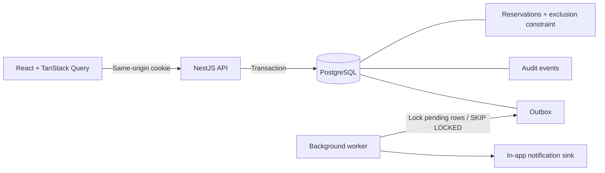
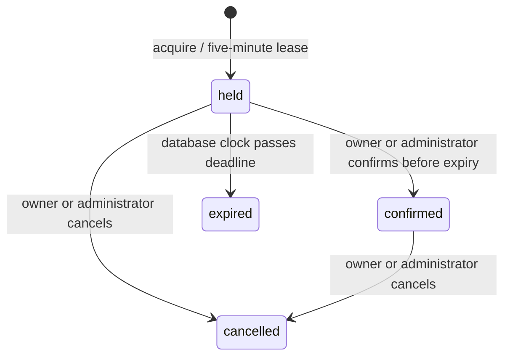

# Architecture and decisions

## Flow

## ADR 001 — Database-enforced exclusivity

**Decision:** an exclusion constraint combines `resource_id WITH =` and `tstzrange(starts_at, ends_at, '[)') WITH &&`, restricted to `held` and `confirmed` records. `btree_gist` supplies the UUID equality operator class.

**Reason:** checking availability and then inserting without a database invariant allows two concurrent requests to book the same interval. A process-local mutex fails across instances. The constraint provides a final defense even for alternate write paths.

**Trade-off:** PostgreSQL-specific schema and a GiST index. Writers of unrelated non-overlapping slots on the same resource are still serialized by the application row lock; this is a conscious simplicity/throughput trade-off for an MVP. Resources can proceed independently.

The API maps PostgreSQL `23P01` to HTTP 409. Ordinary database failures are not mislabeled as booking conflicts.

## ADR 002 — Explicit state machine and expiration

Repeated confirmation/cancellation of the same state returns that state without a second event. Terminal states cannot be revived. Confirmation after the meeting start is rejected.

The exclusion predicate cannot depend on a continuously changing `now()`. Expiry is therefore a persisted transition. All service mutation paths lock the resource first. On-demand expiry runs before allocation; worker downtime does not keep an expired hold unavailable. If a confirmation discovers an expired hold, expiry is committed before the service returns a conflict; throwing inside that transaction would incorrectly roll back expiry.

Database time determines the lease deadline and expiry. A short statement timeout bounds lock waits. The worker locks resources in deterministic ID order and skips locked rows.

## ADR 003 — Scoped idempotency

Requests carry a user-scoped key. A transaction advisory lock serializes concurrent uses of that key, then a canonical fingerprint checks resource, trimmed title and normalized UTC timestamps. Identical retries return the existing reservation's current state; changed input returns 409. Failed acquisitions do not consume the key. The MVP retains keys indefinitely; retention/expiry is future operational work.

Lock order is advisory key → resource → reservation/event writes. Transition and expiry workers never acquire idempotency locks, avoiding an inverted lock dependency.

## ADR 004 — Transactional outbox before an external broker

Reservation changes, audit records and pending events are written in one database transaction. A polling worker claims pending events with `FOR UPDATE SKIP LOCKED`, writes a notification keyed by event ID, then marks delivery in the same transaction. A crash rolls back that delivery attempt; another worker can retry it. The local database sink cannot contain duplicate event IDs.

This is **not a promise of exactly-once delivery to arbitrary external systems**. An email/webhook adapter would require at-least-once delivery, provider idempotency, retry backoff, dead-letter handling, timeouts and observability. No email adapter is present.

## ADR 005 — Identity and tenant boundaries

Opaque session tokens are 256 random bits. Only a SHA-256 digest is persisted. Passwords use randomly salted scrypt. Session cookies use HttpOnly, SameSite=Strict, an eight-hour lifetime, and Secure in production mode. Mutating browser requests reject unexpected Origin or cross-site Fetch Metadata. DTOs reject unknown properties and require offset-bearing ISO timestamps.

Every resource lookup is scoped to the authenticated organization; user IDs and organization IDs are never accepted from reservation input. Composite foreign keys stop cross-organization associations in the schema. Owner/admin checks protect mutations. Members see occupied time ranges but not other members' meeting titles; audit history is owner-only for members and organization-wide for administrators.

There is no PostgreSQL row-level security in this MVP. Tests verify query-level isolation; adding RLS requires a separate transaction-scoped identity design. Login throttling is in memory and must move to shared infrastructure before horizontally scaling a public service. Cleanup policies for expired sessions, keys, audit and outbox history are not implemented.

## ADR 006 — SQL and framework boundaries

Parameterized SQL makes locking, range constraints and transactional ordering explicit. NestJS handles HTTP concerns, validation, dependency injection, lifecycle and documentation; the reservation service owns state transitions. A small migration ledger with a PostgreSQL advisory lock serializes schema migration attempts. No ORM abstraction hides the concurrency mechanisms.

React and TanStack Query manage server state with polling and mutation invalidation. The server remains authoritative. Vite proxies `/api` in local development so no cross-origin credential sharing is necessary. Room illustrations are CSS; there are no paid image dependencies.

## Operational limits

Health currently checks database connectivity. JSON request logs contain correlation IDs, method, path, status and duration, never passwords or session cookies. This is basic observability, not a complete metrics/tracing solution. OpenAPI is exposed for local inspection. Demo accounts cannot be seeded when `NODE_ENV=production`.

The API binds to loopback by design. A production deployment needs trusted-proxy configuration, TLS, secrets management, migration rollout policy, backups with restore exercises, SLOs and capacity validation. No deployment is configured or claimed.

## References

- [PostgreSQL range and exclusion constraints](https://www.postgresql.org/docs/18/rangetypes.html)
- [PostgreSQL explicit locking](https://www.postgresql.org/docs/18/explicit-locking.html)
- [NestJS validation](https://docs.nestjs.com/techniques/validation)
